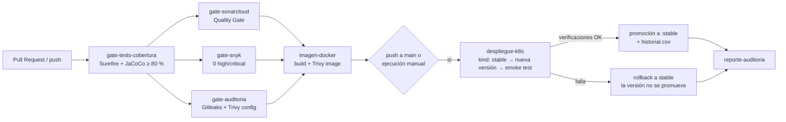
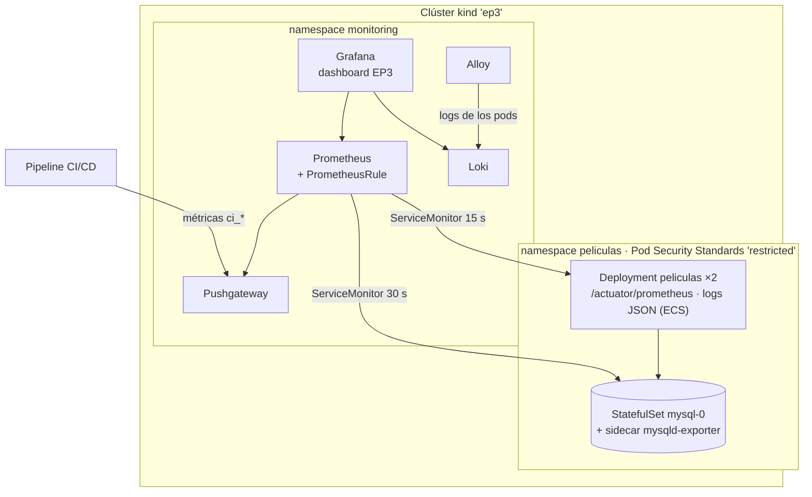

# Microservicio Películas · DevOps (DOY0101)

[](https://github.com/Daniloko12/devops_007d_ols/actions/workflows/ci.yml)

API REST de catálogo de películas (Java 21, Spring Boot 4.0.10, MySQL 8.0) con pipeline CI/CD,
despliegue orquestado en Kubernetes y observabilidad completa (métricas, logs, trazas, alertas y dashboards).

- [Evaluación Parcial 3: Observabilidad y entornos reales](#evaluación-parcial-3-observabilidad-y-entornos-reales)
- [Documentación de evaluaciones anteriores (EP1 y EP2)](#documentación-de-evaluaciones-anteriores-ep1-y-ep2)

---

## Evaluación Parcial 3: Observabilidad y entornos reales

### 1. Arquitectura

**Pipeline** (`.github/workflows/ci.yml`): cada gate termina con exit code distinto de 0 si no se
cumple su umbral, y los jobs que dependen de él no se ejecutan.



**Entorno de ejecución** (Kubernetes con kind, el mismo en el PC y en el runner del pipeline):



### 2. Herramientas por etapa

| Etapa | Herramienta | Versión | Configuración |
|---|---|---|---|
| Build y pruebas | Maven, JUnit 5, Mockito, H2 | Maven 3.9 (wrapper), Java 21 | `peliculas/peliculas/peliculas/pom.xml` |
| Cobertura | JaCoCo | 0.8.14 | `pom.xml` (`cobertura.minima` = 0.80) |
| SAST | SonarCloud (scanner Maven) | — | `pom.xml` (`sonar.*`), job `gate-sonarcloud` |
| SCA | Snyk CLI | 1.x | `.snyk`, job `gate-snyk` |
| Secretos | Gitleaks + secret scanning / push protection de GitHub | 8.30.1 | job `gate-auditoria` |
| Configuración IaC | Trivy `config` | 0.69.3 | `.trivyignore.yaml`, job `gate-auditoria` |
| Imagen | Docker multi-stage + Trivy `image` | Trivy 0.69.3 | `Dockerfile`, job `imagen-docker` |
| Registro | GitHub Container Registry | — | `ghcr.io/daniloko12/devops_007d_ols` |
| Orquestación | Kubernetes (kind) + Kustomize | — | `k8s/`, `monitoring/kind-config.yaml` |
| Métricas | Spring Boot Actuator + Micrometer + Prometheus | kube-prometheus-stack 93.6.0 | `application.properties`, `k8s/servicemonitor.yaml` |
| Logs | Logs estructurados ECS + Alloy + Loki | Loki 21.4.2 · Alloy 1.16.0 (charts) | `application-k8s.properties`, `monitoring/alloy-values.yaml` |
| Trazas | Micrometer Tracing (Brave) | — | `traceId`/`spanId` en cada log |
| Alertas | PrometheusRule | — | `k8s/prometheusrule.yaml` |
| Dashboards | Grafana (provisionado por sidecar) | — | `k8s/dashboards/peliculas-overview.json` |
| Métricas del pipeline | Pushgateway + `historial.csv` | Pushgateway 3.11.2 (chart) | `scripts/metricas-ci.py`, rama `metrics-history` |
| Gobernanza | Ruleset de GitHub, Dependabot | — | `.github/rulesets/proteccion-ramas.json`, `.github/dependabot.yml` |

Las versiones de los charts de Helm están fijadas en `monitoring/versions.env` y la imagen de MySQL
por digest en `k8s/mysql.yaml`, para que el PC y el pipeline instalen exactamente lo mismo.

### 3. Gates de calidad y seguridad

| # | Gate (job) | Umbral | Si no se cumple |
|---|---|---|---|
| 1 | `gate-tests-cobertura` | 0 tests fallidos | Exit 1, no corre ningún job posterior |
| 2 | `gate-tests-cobertura` (JaCoCo) | Líneas y ramas ≥ 80 % | Exit 1, no corre ningún job posterior |
| 3 | `gate-sonarcloud` | Quality Gate aprobado (`sonar.qualitygate.wait=true`) | Exit 1, no se construye la imagen |
| 4 | `gate-snyk` | 0 vulnerabilidades high/critical | Exit 1 (o 2 si el escáner falla), no se construye la imagen |
| 5 | `gate-auditoria` (Gitleaks) | 0 secretos en los commits del cambio | Exit 1, no se construye la imagen |
| 6 | `gate-auditoria` (Trivy config) | 0 HIGH/CRITICAL en Dockerfile y manifiestos | Exit 1, no se construye la imagen |
| 7 | `imagen-docker` (Trivy image) | 0 HIGH/CRITICAL con corrección disponible | Exit 1, la imagen no se publica |
| 8 | `despliegue-k8s` (`smoke-test.sh`) | Rollout completo y 10 verificaciones | Rollback a `stable`, la versión no se promueve, exit 1 |

- El plan Free de SonarCloud solo analiza `main` y los PR hacia `main`; en `develop` el gate se informa como "no aplica".
- Los resultados de Snyk, Gitleaks y Trivy se publican en la pestaña **Security** (SARIF).
- Las excepciones aceptadas tienen justificación y vencimiento en `.snyk` y `.trivyignore.yaml`.
- El detalle por control (evidencia, retención y referencias ISO/IEC 27001:2022) está en [docs/cumplimiento.md](docs/cumplimiento.md).

**Protección de ramas** (ruleset `proteccion-main-develop`, aplicado con `scripts/configurar-repositorio.sh`):
`main` y `develop` solo aceptan cambios por Pull Request con los gates 1 a 7 como checks obligatorios,
sin force-push, sin borrado y sin excepciones para administradores. El job `reporte-auditoria`
verifica en cada ejecución que la protección siga activa (control 9 del reporte).

### 4. Despliegue en Kubernetes

| Recurso | Archivo | Configuración relevante |
|---|---|---|
| Namespace | `k8s/namespace.yaml` | Pod Security Standards `restricted` (enforce, warn, audit) |
| App | `k8s/deployment.yaml` | 2 réplicas, RollingUpdate `maxUnavailable: 0` / `maxSurge: 1`, `progressDeadlineSeconds: 180`, startup/liveness/readiness en `/actuator/health/*`, usuario no root, sistema de archivos de solo lectura, requests 250m/384Mi, límites 1 CPU/768Mi |
| Base de datos | `k8s/mysql.yaml` | StatefulSet con PVC de 1 Gi, usuario `mysql` (UID 999), credenciales desde el Secret `mysql-credentials`, sidecar `mysqld-exporter` con usuario de solo lectura |
| Métricas | `k8s/servicemonitor.yaml` | App cada 15 s, MySQL cada 30 s |
| Alertas | `k8s/prometheusrule.yaml` | 8 reglas (sección 6) |
| Dashboard | `k8s/dashboards/` | ConfigMap con la etiqueta `grafana_dashboard: "1"` |
| Configuración | `k8s/kustomization.yaml` | ConfigMaps generados con hash (un cambio de configuración reinicia los pods) |

**Secuencia de despliegue en el pipeline** (`despliegue-k8s`, solo en push a `main` o ejecución manual):

1. Crea el clúster kind e instala el stack de monitoreo (`install-monitoring.sh`).
2. Crea credenciales aleatorias para la base de datos (`create-secrets.sh`); nunca aparecen en los logs.
3. Despliega la imagen `stable` vigente (`desplegar.sh`), que representa la versión en producción.
4. Despliega la imagen nueva `sha-<commit>` y ejecuta `smoke-test.sh`:
   códigos HTTP 200/404/400 (incluida la búsqueda por título), métrica `app_build_version`, réplicas leídas por Prometheus,
   `mysql_up`, Pushgateway y líneas de log en Loki.
5. Si todo pasa: promueve la imagen a `:stable`, envía las métricas al Pushgateway y agrega una fila a `historial.csv`.
6. Si algo falla: `kubectl rollout undo` vuelve a `stable`, se verifica de nuevo y la versión no se promueve.

Cada revisión queda registrada con la imagen que trae (`kubectl rollout history`, anotación `change-cause`).
La ejecución manual con `simular_falla_despliegue = true` despliega la versión apuntando a una base de
datos inexistente para comprobar el rollback.

### 5. Observabilidad

| Señal | Origen | Destino | Cómo consultarla |
|---|---|---|---|
| Métricas HTTP | Micrometer (`http_server_requests_seconds_*`, con histograma) | Prometheus | Dashboard, fila "Tráfico y errores HTTP" |
| Métricas JVM y de recursos | Micrometer, cAdvisor, kube-state-metrics | Prometheus | Fila "Recursos: CPU y memoria" |
| Métricas de negocio | Contador `peliculas_operaciones_total{operacion}` | Prometheus | Panel "Operaciones de negocio" |
| Versión desplegada | Gauge `app_build_version{version, commit}` | Prometheus | Panel "Versión en producción" |
| Base de datos | `mysqld-exporter` (`mysql_up`, conexiones, consultas) | Prometheus | Paneles "Base de datos MySQL" y "MySQL: …" |
| Logs | JSON ECS por consola (perfil `k8s`), con `traceId`/`spanId` | Alloy → Loki | Fila "Logs (Loki)", filtro por `traceId` o texto |
| Pipeline | `scripts/metricas-ci.py` (`ci_*`) | Pushgateway → Prometheus | Fila "CI/CD" |
| Historial del pipeline | `scripts/registrar-historial.sh` | `historial.csv` en la rama `metrics-history` | GitHub o cualquier planilla |

**Dashboard "EP3 · Microservicio Películas"** (carpeta "EP3 Peliculas" en Grafana):

| Fila | Paneles |
|---|---|
| Disponibilidad y versión desplegada | Réplicas respondiendo, disponibilidad en el rango, MySQL, alertas activas, versión en producción |
| Tráfico y errores HTTP | Peticiones/s por endpoint, respuestas por código, tasa de error 5xx y 4xx, latencia p50/p95/p99, operaciones de negocio |
| Recursos: CPU y memoria | CPU y memoria por pod vs. límite, heap de la JVM, reinicios, conexiones y consultas de MySQL |
| CI/CD: métricas del pipeline | Cobertura de líneas y ramas, tests ejecutados/fallidos, duración del build, tiempo de despliegue, vulnerabilidades high/critical, última ejecución |
| Logs (Loki) | Líneas por nivel, errores y advertencias, búsqueda libre |

El clúster del pipeline se elimina al terminar cada ejecución, así que el registro permanente de las
métricas del pipeline es `historial.csv`. En el entorno local, `scripts/push-metricas-ci.sh` envía las
métricas del último `mvnw clean verify` al Pushgateway para verlas en la fila CI/CD.

### 6. Métricas, umbrales y acciones automáticas

| Métrica / señal | Umbral | Acción automática | Dónde |
|---|---|---|---|
| Tests fallidos | > 0 | El pipeline se detiene; no se construye la imagen | `gate-tests-cobertura` |
| Cobertura de líneas o ramas | < 80 % | El build falla (`jacoco:check`) | `gate-tests-cobertura` |
| Quality Gate de SonarCloud | Fallido | Bloquea la imagen y el despliegue | `gate-sonarcloud` |
| Vulnerabilidades high/critical en dependencias | > 0 | Bloquea la imagen y el despliegue | `gate-snyk` |
| Secretos en el código | > 0 | Bloquea el PR (y GitHub rechaza el push si reconoce el secreto) | `gate-auditoria`, push protection |
| Configuración HIGH/CRITICAL | > 0 | Bloquea la imagen | `gate-auditoria` |
| Vulnerabilidades HIGH/CRITICAL con corrección en la imagen | > 0 | La imagen no se publica | `imagen-docker` |
| Rollout sin progreso | 180 s (`progressDeadlineSeconds`) | Rollback a `stable` | `despliegue-k8s` |
| Verificaciones post-despliegue | Cualquier falla | Rollback a `stable`; la versión no se promueve | `smoke-test.sh` |
| Réplicas respondiendo (`up`) | Ninguna durante 1 min | Alerta `PeliculasSinReplicasDisponibles` (critical) | PrometheusRule |
| Réplica caída | `up == 0` durante 2 min | Alerta `PeliculasReplicaCaida` (warning) | PrometheusRule |
| `mysql_up` | 0 o ausente durante 1 min | Alerta `MySQLCaido` (critical) | PrometheusRule |
| Tasa de error 5xx (sin `/actuator`) | > 5 % durante 5 min | Alerta `PeliculasTasaErrores5xxAlta` (critical) | PrometheusRule |
| Latencia p95 (sin `/actuator`) | > 1 s durante 5 min | Alerta `PeliculasLatenciaP95Alta` (warning) | PrometheusRule |
| Reinicios de contenedores | > 2 en 15 min | Alerta `PeliculasReiniciosFrecuentes` (warning) | PrometheusRule |
| Memoria del pod / límite | > 90 % durante 5 min | Alerta `PeliculasMemoriaCercaDelLimite` (warning) | PrometheusRule |
| CPU del pod / límite | > 80 % durante 10 min | Alerta `PeliculasCPUCercaDelLimite` (warning) | PrometheusRule |
| Liveness / readiness | Falla de la probe | Kubernetes reinicia el contenedor / lo saca del Service | `k8s/deployment.yaml` |

Las alertas activas se ven en Prometheus (`/alerts`) y en el panel "Alertas activas" del dashboard.

### 7. Ejecución local

**Requisitos:** Docker, kind, kubectl, Helm, OpenSSL, Python 3 y curl. Para las pruebas: Java 21
(el proyecto incluye Maven Wrapper).

```bash
# Entorno completo: clúster kind + monitoreo + imagen + MySQL + app + verificación
./scripts/local-up.sh

# Accesos (dejar corriendo en otra terminal)
./scripts/port-forward.sh
#   App (Swagger): http://localhost:8080/swagger-ui.html
#   Grafana:       http://localhost:3000   (usuario admin, la clave la imprime el script)
#   Prometheus:    http://localhost:9090/targets   ·   alertas: /alerts

# Tráfico de prueba para poblar el dashboard (200, 201, 204, 400 y 404)
./scripts/generar-trafico.sh 120

# Pruebas + cobertura, y envío de esas métricas a la fila CI/CD del dashboard
(cd peliculas/peliculas/peliculas && ./mvnw clean verify)
./scripts/push-metricas-ci.sh

# Eliminar todo el entorno local
./scripts/local-down.sh
```

Con Docker Compose (sin Kubernetes ni monitoreo), desde la raíz del repositorio:
`cp .env.example .env`, completar las claves y ejecutar `docker compose up --build`.

### 8. Evidencia

| Evidencia | Ubicación |
|---|---|
| Ejecuciones del pipeline y reporte de auditoría de cada una | [Actions](https://github.com/Daniloko12/devops_007d_ols/actions/workflows/ci.yml) (resumen del run y artefacto `reporte-auditoria-<n>`) |
| Estado del clúster, logs y `rollout history` de cada despliegue | Artefacto `evidencia-despliegue` de cada run |
| Imágenes publicadas y versión en producción | [GHCR](https://github.com/Daniloko12/devops_007d_ols/pkgs/container/devops_007d_ols) (tags `sha-<commit>` y `stable`) |
| Historial de métricas del pipeline | [`historial.csv`](https://github.com/Daniloko12/devops_007d_ols/blob/metrics-history/historial.csv) |
| Hallazgos de seguridad | Pestaña [Security](https://github.com/Daniloko12/devops_007d_ols/security) |
| Análisis estático | [SonarCloud](https://sonarcloud.io/project/overview?id=Daniloko12_devops_007d_ols2) |
| Reglas de protección vigentes | [Rules](https://github.com/Daniloko12/devops_007d_ols/rules) |
| Política de seguridad y matriz de cumplimiento | [SECURITY.md](SECURITY.md) · [docs/cumplimiento.md](docs/cumplimiento.md) |

### 9. Estructura del repositorio

```text
.github/
  workflows/ci.yml                 pipeline CI/CD (gates, imagen, despliegue, auditoría)
  rulesets/proteccion-ramas.json   protección de main y develop
  dependabot.yml                   actualizaciones de dependencias, acciones e imágenes
  pull_request_template.md         checklist de cada PR
peliculas/peliculas/peliculas/     microservicio Spring Boot (código, pruebas, pom.xml)
Dockerfile                         imagen multi-stage, usuario no root
docker-compose.yml · .env.example  ejecución con Docker Compose (sin Kubernetes)
k8s/                               manifiestos de Kubernetes (Kustomize), alertas y dashboard
monitoring/                        clúster kind y valores de Helm del stack de monitoreo
scripts/                           entorno local, despliegue, verificación, métricas y auditoría
docs/cumplimiento.md               matriz de cumplimiento y registro de excepciones
SECURITY.md                        política de seguridad
.snyk · .trivyignore.yaml          excepciones documentadas con vencimiento
```

### 10. Justificación técnica de las decisiones
Para esta tercera evaluación decidí llevar el microservicio de películas de un entorno local con Docker Compose a un entorno orquestado con Kubernetes (`kind`) y observabilidad completa, manteniendo la misma base de Java 21, Spring Boot y MySQL.

Elegí `kind` junto con Kustomize porque me permite levantar el mismo clúster de Kubernetes tanto en mi equipo como en el runner del pipeline, con configuraciones ordenadas y variables separadas para evitar tener que editar archivos a mano cada vez que cambio algo. También fijé las versiones de los charts de Helm y el digest de MySQL para que el entorno sea repetible y no cambie solo por una actualización inesperada.

En la parte de calidad y seguridad, subí la exigencia respecto a la EP2: no solo se corren las pruebas y los análisis de SonarCloud y Snyk, sino que agregué cobertura mínima del 80% con JaCoCo, escaneo de secretos con Gitleaks, revisión de configuración/imágenes con Trivy y protección de ramas en GitHub (`main` y `develop`). Si algo falla o queda bajo el umbral, el pipeline corta ahí mismo y no deja pasar el cambio.

Para el despliegue en Kubernetes configuré dos réplicas con estrategia `RollingUpdate`, sondas de salud (`/actuator/health/*`), usuario no root y `smoke-test.sh` después de desplegar. Si el despliegue falla o las verificaciones no pasan, se hace `rollback` automático a `:stable` para no dejar una versión rota activa. Y para la observabilidad, junté métricas con Prometheus y Grafana, logs estructurados con `traceId`/`spanId` enviados por Alloy hacia Loki, reglas de alerta (`PrometheusRule`) y el registro de métricas del pipeline en `Pushgateway` y `historial.csv` (en la rama `metrics-history`), ya que el clúster del pipeline se destruye al terminar cada corrida.

### 11. Conclusiones
Al unir el pipeline CI/CD, los controles de seguridad, el despliegue en Kubernetes y el stack de observabilidad, el microservicio de películas queda mucho más protegido y fácil de revisar cuando ocurre algún problema. Ya no depende solo de que la compilación o las pruebas pasen en un momento puntual, sino que existen filtros automáticos antes de construir y publicar la imagen, y verificaciones después de desplegar.

Contar con métricas de HTTP, JVM, base de datos, alertas y logs centralizados en Grafana y Loki permite ver cómo se comporta el servicio y qué pasa cuando hay errores o se simula una falla de despliegue. En conjunto, el proyecto pasa de ser solo una API funcional con un pipeline básico a un flujo de trabajo más completo y cercano a lo que se exige en entornos reales de DevOps.

### 12. Reflexión individual
En lo personal, pasar de Docker Compose a Kubernetes con observabilidad completa fue lo que más me exigió en esta evaluación. Al principio me costó harto entender cómo encajaban todas las piezas juntas: el clúster en `kind`, los manifiestos de Kubernetes, Prometheus, Grafana, Alloy, Loki y el envío de métricas del pipeline.

Cuando aparecían errores en el pipeline o en los pods, tuve que ir revisando paso a paso los logs, las sondas, las reglas de protección y los scripts para cachar qué estaba fallando. Aunque al comienzo se veía gigante y enredado, ir probándolo y viendo las métricas, alertas y logs funcionando en el dashboard me ayudó a entender mucho mejor cómo se monitorea y protege un servicio en la práctica.

### 13. Declaración de uso de Inteligencia Artificial
En cumplimiento de las indicaciones de uso ético de Inteligencia Artificial de la asignatura, Claude generó el código Java y sus pruebas, el pom.xml, el Dockerfile, los manifiestos de Kubernetes, los valores de Helm, los scripts, el pipeline ci.yml y el dashboard de Grafana, y redactó la documentación técnica (secciones 1 a 9 de este README, SECURITY.md, docs/cumplimiento.md y la plantilla de PR).
También diagnosticó las fallas del pipeline a partir de los logs. Todas las configuraciones, pruebas, evidencias y decisiones del proyecto fueron revisadas y validadas por mí.

**Referencias**

Anthropic. (2026). *Claude* (versión Opus 5.5) [Modelo de lenguaje de gran tamaño]. https://claude.ai

---

## Documentación de evaluaciones anteriores (EP1 y EP2)

*** Documentacion del Microservicio - Proyecto DevOps EP1 ***

*** Descripcion del Proyecto ***
Aqui dejo el microservicio base que ocupe para la Evaluacion Parcial 1. Esta hecho en Java 21, utilizando el patron Controller-Service-Repository. Ocupe esta estructura porque me facilita harto separar las responsabilidades del codigo y mantener todo higienico y ordenado.

*** Estrategia de Ramas: Por que ocupe GitFlow?  *** 
Elegi GitFlow principalmente porque me permite trabajar de forma super ordenada y segura. Me facilito mucho la vida poder separar lo que esta listo para produccion (en la rama `main`) del codigo en el que estoy trabajando dia a dia (en la rama `develop`).
 Para cosas nuevas: Cuando tuve que agregar herramientas o configuraciones, simplemente saque ramas `feature/` desde `develop`. Esto me permitio avanzar sin miedo a romper el codigo principal.
 
 Para emergencias: Si llega a fallar algo critico en produccion, esta estrategia me permite sacar una rama `hotfix/` directamente desde `main`, arreglarlo rapido y subirlo sin enredarme con el desarrollo que esta a medias.

*** Trazabilidad y Flujo Colaborativo ***
Para mantener el repositorio limpio y sin basura, segui la convencion de mensajes de commit (usando etiquetas como feat:, fix:, docs:, chore:, ci:). Esto me permitio tener un historial clarito donde se entiende perfecto que hice en cada paso. Ademas, simule el trabajo colaborativo integrando los cambios siempre mediante Pull Requests hacia `develop`, asegurando que el codigo pase por una revision antes del merge.

*** Automatizacion Continua (CI/CD) ***
Configure GitHub Actions creando un archivo `ci.yml`. Ocupe esta herramienta porque me automatiza la verificacion del codigo. Cada vez que tiro un push a `develop` o armo un Pull Request a `main`, el pipeline de GitHub compila el microservicio en la nube por mi cuenta. Me permite estar cien por ciento seguro de que no estoy subiendo codigo roto a produccion.

*** Declaracion de uso de Inteligencia Artificial (IA) ***
Para el desarrollo de este encargo, utilice Inteligencia Artificial (Gemini) como apoyo. Especificamente, ocupe la IA para que me guiara con descripciones y el paso a paso de los comandos de Git en la terminal, ya que acordarme de la sintaxis exacta de los comandos y de como conectar el repositorio fue lo que me costo un poco mas de lo normal. Todo el analisis de la arquitectura, revision del codigo y ejecucion fue validado por mi.


*** Trazabilidad y Calidad del Pipeline ***

Para garantizar la estabilidad y fiabilidad en cada despliegue, el ciclo de vida del microservicio esta automatizado mediante GitHub Actions (`ci.yml`). El pipeline consta de las siguientes etapas:
  **Construccion, Pruebas Automatizadas y Reporte HTML:** Se compila el codigo utilizando Maven y JDK 21, ejecutando automaticamente las pruebas para asegurar que los nuevos cambios no rompan la logica de negocio y haciendo que el job falle de inmediato si alguna prueba falla. Para que los tests corran en la nube sin depender de una base de datos MySQL local, ocupe `@WebMvcTest` con `@MockitoBean` en `PeliculaControllerTest` para aislar el controlador[cite: 1], e inyecte directamente las propiedades de una base de datos en memoria **H2** en `PeliculasApplicationTests`[cite: 1]. Ademas, configure el plugin de Surefire para generar el reporte de pruebas en formato HTML y subirlo automaticamente como un artefacto descargable (`upload-artifact`) desde GitHub Actions[cite: 2].

  **Analisis de Seguridad Estatico (SAST) y Escaneo de Dependencias (SCA):** Se integra **SonarCloud** para escanear el codigo fuente en busqueda de vulnerabilidades, *security hotspots* y *code smells* pasando por el Quality Gate[cite: 5]. Ademas, integre **Snyk** dentro del pipeline para analizar el archivo `pom.xml`[cite: 1] y detectar vulnerabilidades de seguridad en las librerias del proyecto. Adicionalmente, **Dependabot** alerta sobre dependencias y acciones desactualizadas[cite: 1, 6].

  **Contenerizacion:** Se utiliza un `Dockerfile` multi-etapa (multi-stage build) para empaquetar el microservicio de manera reproducible y generar una imagen optimizada.
  **Despliegue y Registro:** Tras pasar las pruebas y los analisis de seguridad, la imagen Docker se construye y sube automaticamente al GitHub Container Registry (GHCR).

***Orquestacion***
La orquestacion local se maneja mediante un archivo `docker-compose.yml`[cite: 1], el cual levanta el microservicio y el contenedor de la base de datos MySQL funcionando en conjunto. Para dejarlo bien configurado, saque las credenciales a un archivo `.env` por seguridad[cite: 1], agregue volumenes (`volumes`) para que los datos de MySQL persistan si se apaga el contenedor, e implemente un `healthcheck` combinado con `depends_on` para asegurar que el microservicio espere a que la base de datos este cien por ciento lista antes de arrancar.

---
*** Conclusiones y Reflexiones Personales ***


**Reflexion **
En lo personal, lo que mas me hizo pensar en esta evaluacion fue configurar bien GitHub Actions y lograr que las pruebas pasaran en la nube. Al principio el pipeline no me arrancaba cuando subia cambios a la rama main, asi que tuve que meterme a editar el archivo `ci.yml` a mano para arreglar los triggers. Despues, cuando habilite las pruebas, el pipeline se caia porque seguia buscando el dialecto de MySQL, asi que aprender a inyectar H2 directo en la clase de prueba y rescatar la carpeta `target` para descargar el reporte HTML me ayudo mucho a entender como funcionan los entornos aislados. Tambien aprendi harto sobre seguridad: en vez de dejar credenciales tiradas en el codigo, entendi como usar el archivo `.env` en local[cite: 1] y los Secrets de GitHub para guardar los tokens de SonarCloud y Snyk de forma segura. Al final, me di cuenta de que manejar Git directamente desde la interfaz de Visual Studio Code es mucho mas comodo y te salva de los tipicos errores por teclear mal en la terminal[cite: 1].

** Conclusion Final **
En resumen, sacar adelante este proyecto me sirvio harto para entender como se trabaja realmente en el mundo DevOps. Al principio costo un poco armar todo el puzzle entre GitHub, las pruebas con H2, SonarCloud, Snyk y Docker Compose[cite: 1, 5], pero una vez que el pipeline quedo en verde, me di cuenta del tremendo alivio que es tener todo automatizado. Ya no hay que estar probando a mano ni adivinando si el codigo va a fallar al subirlo. Aplicar GitFlow junto con estas herramientas de integracion continua, pruebas y seguridad me deja una base super solida para no romper la produccion y trabajar de forma mucho mas profesional de aqui en adelante[cite: 3].